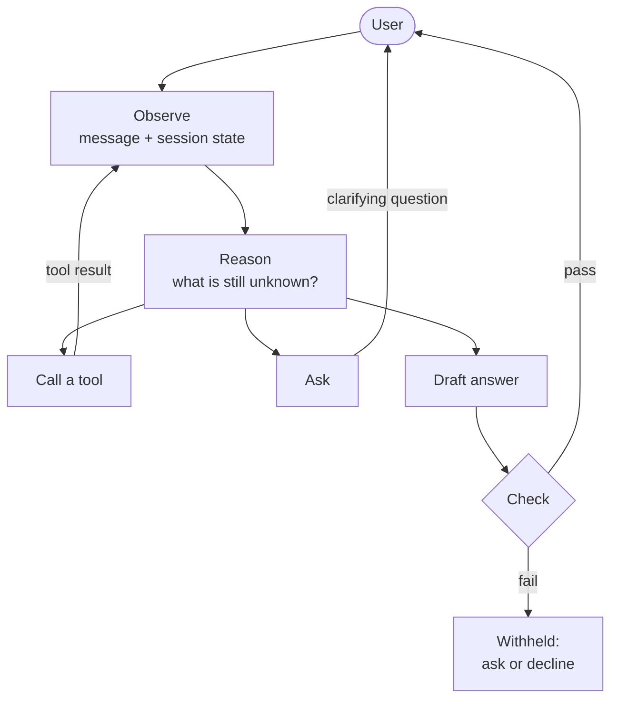

# Rikanverse

**A proactive, multilingual, voice-native AI agent for the UK property market, built on a ReAct (Reason + Act) architecture.**

Rikanverse helps tenants, buyers and landlords with questions that filter-based property portals cannot answer. It knows when to **ask**, when to **act**, when to **answer**, and when to **decline**.

[Live app (closed beta)](https://app.rikanverse.com/) · [Website](https://rikanverse.com/) · [Demo: Landlord](https://www.youtube.com/watch?v=BeVBdet2ClM) · [Demo: Tenant](https://www.youtube.com/watch?v=qA67hR3qKrY) · [Paper](https://doi.org/10.5281/zenodo.23887913)

> **Status:** closed beta. This repository documents the system and its research. The production source code is proprietary and not published here.

---

## Why Rikanverse?

Renting in the UK depends on rules most people don't know. Whether you owe Council Tax, which tenancy agreement applies, or whether you can rent without a UK credit history depends on *your* situation, not on the words in a listing.

Most property apps match keywords and tick boxes. Rikanverse reasons through your situation, asks for what it needs to know, and acts on your behalf.

## Features

**For tenants and buyers**
- Describe your ideal home by voice or text, including lifestyle preferences
- Ask practical questions about Council Tax, tenancy agreements or mortgages
- Get matched to Rikanverse listings first
- Get routed to existing UK property platforms with filters already set when nothing fits
- Talk in your native language

**For landlords and agents**
- Register a listing by speaking or typing, with no forms to fill in
- Ask market questions such as *"What rent should I charge?"*
- Understand Council Tax and other obligations

## How it works

At every turn, the agent observes the conversation, reasons about what is still unknown, and chooses one action. A draft answer never goes straight to the user. It must pass a set of checks first.



### Design principles

| Principle | What it means |
|---|---|
| **Asking is an action** | When a fact is missing, the agent asks a targeted question instead of guessing |
| **Small, typed action space** | The agent can only use a fixed set of tools: search, listing creation and hand-off. This limits what a faulty plan can do |
| **Persistent state** | Session memory carries constraints across a long conversation |
| **Two personas, one engine** | Tenants and landlords share the reasoning engine but keep separate state and permissions |
| **Voice-native** | Voice and text run as separate pipelines, each with its own latency budget |
| **Decline rather than guess** | Every draft is checked. If it fails, it is withheld, and the agent asks for more information or recommends professional advice |

## Not a chatbot

Rikanverse uses foundation models, but its behaviour comes from the orchestration around the model, not from the model alone.

| | Conventional chatbot | Rikanverse agent |
|---|---|---|
| **Control flow** | One message, one reply | Multi-step reason-and-act loop within each turn |
| **Missing information** | Guesses or replies "not found" | Asks a targeted clarifying question |
| **Actions** | Produces text only | Calls typed tools: search, listing creation, hand-off |
| **Memory** | Current message or a short window | Persistent session state |
| **Users** | A single role | Tenants and landlords, with separate state and permissions |
| **Uncertain answers** | Released as fluent text | Checked, and withheld if a check fails |
| **Voice** | Text-to-speech added to a text bot | Separate voice pipeline |

### Example

> *"I don't have a UK credit history or a guarantor. Can I get this flat?"*

A keyword bot searches the advert for "credit history" or "guarantor", finds nothing, and the conversation ends.

Rikanverse works through it instead:

1. **Reason:** No UK credit history and no guarantor means a standard reference check will likely fail, but there may be alternatives.
2. **Act:** Look up which referencing alternatives the letting agency accepts.
3. **Observe:** The agency accepts rent paid in advance or an approved guarantor service.
4. **Respond:** Explain both routes and offer to start the application.

## Safety and reliability

Before release, every draft answer is checked on four points:

- **Support:** is the answer supported?
- **Consistency:** does it fit the user's stated situation?
- **Confidence:** is the agent confident enough to answer?
- **Safety:** is the input and output free of prompt injection, and is personal data protected?

These checks reduce risk but cannot guarantee correctness. Rikanverse gives general guidance, not legal advice. Implementation details are withheld because the system is under active commercial development.

## Evaluation

The system works end-to-end in recorded sessions. A formal evaluation is planned:

- **Core metric:** score each answer as *correct*, *wrong* or *declined*, and report the trade-off between correct and decline rates. The wrong rate is the safety measure.
- **Ablation:** remove one check at a time and measure the change in wrong answers.
- **Multilingual consistency:** ask the same questions in several languages and compare results.
- **Robustness and latency:** measure prompt-injection success rates and voice round-trip latency.

**Preliminary user survey** (May and September 2026, N = 30):

| Statement | All (N = 30) | Tenants (N = 18) |
|---|---|---|
| Filter-based search fails my questions | 60.0% | 66.7% |
| Would value an always-available AI guide | 90.0% | 88.9% |
| Would try a voice-first agent | 90.0% | 94.4% |

Of the 27 respondents who valued an AI guide, 14 said it only matters if the information is accurate.

## Paper

R. Singh, *When to Ask, Act or Decline: AI Engineering Lessons from Rikanverse, a Deployed LLM Agent*, Preprint, Zenodo, 2026. DOI: [10.5281/zenodo.23887913](https://doi.org/10.5281/zenodo.23887913)

```bibtex
@misc{singh2026rikanverse,
  author    = {Singh, Rimjhim},
  title     = {When to Ask, Act or Decline: AI Engineering Lessons from Rikanverse, a Deployed LLM Agent},
  year      = {2026},
  publisher = {Zenodo},
  note      = {Preprint},
  doi       = {10.5281/zenodo.23887913}
}
```

## Author

**Rimjhim (Rémy) Singh**, founder of Rikanverse Ltd., London. Sole architect and developer of Rikanverse.

[GitHub](https://github.com/rimjhimsinghcoder1) · [Medium](https://medium.com/@rimjhimsingh.professional) · [Rimjhim AI Kingdom](https://rimjhimaikingdom.com/)

## License

© 2026 Rikanverse Ltd. All rights reserved. This repository is documentation only. The Rikanverse name, product and source code are proprietary.
